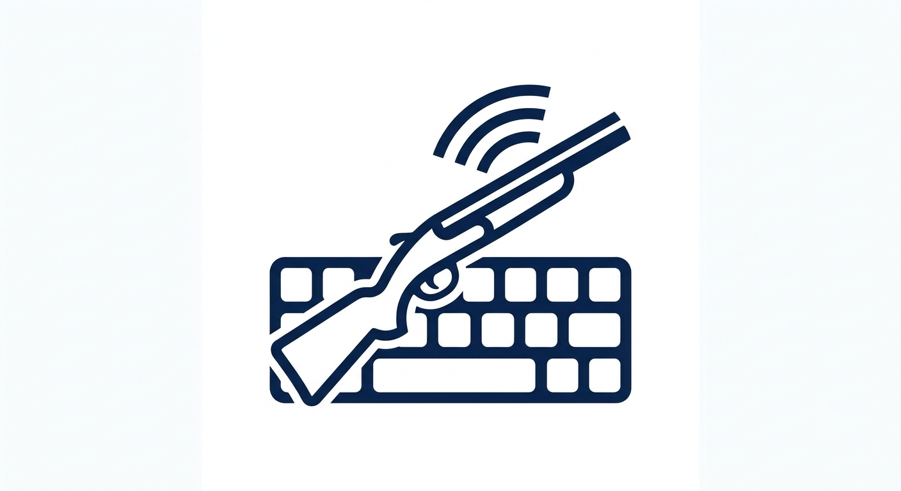

<p align="center">
  
</p>

<h1 align="center">Keyboard Shotgun</h1>

<p align="center">
  <strong>Tactile, low-latency shotgun acoustic feedback on every physical keystroke.</strong>
</p>

<p align="center">
  <a href="https://github.com/Pratik-ovhal/Keyboard-Shotgun/actions/workflows/macos-build.yml"></a>
  
  
  
  
  <a href="LICENSE"></a>
</p>

---

## 🎯 Overview

**Keyboard Shotgun** is a cross-platform desktop utility that transforms mundane typing into a tactile, mechanical, audio-rich experience. Every physical keypress instantly fires a crisp, randomized shotgun sound with natural pitch variation.

Built with Python 3.12, PySide6, `pygame.mixer`, and `pynput`, the app is engineered specifically for **sub-millisecond software processing latency**, zero input freezing, and low CPU/memory overhead.

---

## ✨ Features

- **⚡ Sub-Millisecond Software Processing:** Decoupled multi-threaded event architecture ensures keypress detection is never delayed by audio playback.
- **🎯 Dynamic Pitch Variation:** Uses NumPy linear interpolation to pre-render 8–16 pitch-shifted variations in memory at startup, eliminating the "machine-gun" robotic effect while doing zero disk I/O during typing.
- **🔊 Polyphonic Playback (Overlapping Channels):** Supports up to 32 simultaneous audio channels. Fast typing bursts and chords blend seamlessly without cutting off previous audio tails.
- **🎨 Modern Dark UI:** Premium desktop interface inspired by high-end music players:
  - **Home Dashboard:** Hero card with tactile, animated `SoundWaveVisualizer` that pulses on keypresses, prominent Start/Stop engine toggle, master volume slider, and instant audition button.
  - **Settings View:** Organized cards with custom animated iOS/Fluent-style toggle switches (`ToggleSwitch`), pitch intensity sliders, channel limits, and cooldown controls.
  - **About View:** In-app diagnostics showing live software latency (`< 1.0 ms`), mixer sample rate, buffer size, and platform specifications.
- **🔕 OS Repeat Suppression:** Distinguishes between physical keypresses and OS auto-repeat when holding keys down.
- **🪟 Two Operating Modes:**
  1. **GUI Mode:** Full desktop control center with real-time settings and visualizer.
  2. **Background Tray Mode:** Sits quietly in the Windows notification area or macOS status bar with right-click pause/mute controls.
- **🛡️ Cross-Platform Support:** Fully functional on **Windows 11** and **macOS** (both Apple Silicon ARM64 and Intel x86_64).

---

## 🏗️ System Architecture

Keyboard Shotgun decouples user input from audio execution through a thread-safe producer-consumer pipeline:

```
[ Physical Keystroke ]
          │
          ▼
┌───────────────────────────┐
│   KeyboardListener        │  • pynput global OS hook
│   (core/keyboard_listener)│  • Hardware repeat suppression filter
└─────────────┬─────────────┘
              │  Submits timestamp (non-blocking)
              ▼
┌───────────────────────────┐
│   EventHandler Queue      │  • thread-safe queue.Queue(maxsize=128)
│   (core/event_handler)    │  • Cooldown & burst throttle enforcement
└─────────────┬─────────────┘
              │  Pulls event item
              ▼
┌───────────────────────────┐
│   AudioWorker Thread      │  • Dedicated daemon thread
│   (core/event_handler)    │  • Zero impact on OS typing responsiveness
└─────────────┬─────────────┘
              │  Dispatches audio buffer & calculates latency
              ▼
┌───────────────────────────┐
│   SoundEngine             │  • pygame.mixer with 512-sample buffer
│   (core/sound_engine)     │  • Pre-cached NumPy pitch variations
└─────────────┬─────────────┘
              │
              ├──────────────────────────────┐
              ▼                              ▼
      [ Speaker / DAC ]             [ PySide6 Desktop GUI ]
      (Polyphonic Audio)            (Live Latency & Visualizer Pulse)
```

---

## 📁 Repository Structure

```
Keyboard-Shotgun/
├── .github/
│   └── workflows/
│       └── macos-build.yml       # GitHub Actions CI for macOS ARM64 & Intel
├── core/                         # Core engine logic (decoupled from UI)
│   ├── assets.py                 # Asset locator for dev & frozen PyInstaller
│   ├── config_manager.py         # Thread-safe JSON configuration manager
│   ├── event_handler.py          # Queue producer/consumer pipeline & worker
│   ├── interfaces.py             # Dependency-inversion abstractions
│   ├── keyboard_listener.py      # Global keyboard detection & repeat filter
│   └── sound_engine.py           # Pygame mixer & NumPy pitch generator
├── packaging/                    # Standalone build scripts
│   ├── build_macos.sh            # Native macOS .app bundle builder
│   └── build_windows.ps1         # Windows standalone executable builder
├── platforms/                    # OS-specific integration
│   ├── macos.py                  # macOS Accessibility & permissions helper
│   └── windows.py                # Windows startup registry integration
├── tests/                        # Automated test suite (23 tests)
│   ├── test_audio_engine.py      # Pitch variation, volume, and latency tests
│   ├── test_config.py            # JSON config validation & recovery tests
│   ├── test_gui_and_integration.py # Overlap playback & window lifecycle tests
│   ├── test_keyboard_listener.py # Key debounce & repeat suppression tests
│   └── test_ui_redesign.py       # Sidebar, toggles, visualizer, & UI tests
├── ui/                           # PySide6 Desktop Interface
│   ├── components/
│   │   ├── icons.py              # Procedural vector icons (QPainter)
│   │   ├── toggle_switch.py      # Animated pill toggle switch widget
│   │   └── wave_visualizer.py    # Animated tactile soundwave visualizer
│   ├── main_window.py            # Primary window with 3-page stacked views
│   ├── styles.py                 # Modern dark charcoal & lime QSS theme
│   └── tray_manager.py           # System tray icon and context menu
├── KeyboardShotgun.spec          # PyInstaller multi-platform specification
├── config.json                   # Application configuration file
├── requirements.txt              # Production & development dependencies
├── shotgun.wav                   # Primary shotgun audio sample (16-bit WAV)
├── logo.png                      # Application logo icon
└── main.py                       # Application entrypoint
```

---

## 🚀 Getting Started

### Prerequisites

- **Python 3.12+**
- **Git**
- Audio file: `shotgun.wav` placed in the root directory (included in repo).

### 1. Clone the Repository

```bash
git clone https://github.com/Pratik-ovhal/Keyboard-Shotgun.git
cd Keyboard-Shotgun
```

### 2. Set Up Virtual Environment

**Windows (PowerShell):**
```powershell
python -m venv .venv
.\.venv\Scripts\Activate.ps1
python -m pip install --upgrade pip
pip install -r requirements.txt
```

**macOS / Linux:**
```bash
python3 -m venv .venv
source .venv/bin/activate
pip install --upgrade pip
pip install -r requirements.txt
```

---

## 💻 Running the Application

### GUI Mode (Default)
Launch the full desktop dashboard:
```bash
python main.py
```
*(or explicitly with `python main.py --gui`)*

### Background Mode
Run silently in the system tray without showing the main window on startup:
```bash
python main.py --background
```
*(Right-click the tray icon to pause, open the dashboard, or quit.)*

---

## 🧪 Running Automated Tests

The project includes a comprehensive pytest suite covering audio processing, mixer concurrency, keyboard filtering, configuration recovery, and UI components:

```bash
pytest -v
```

All 23 unit and integration tests run headlessly in CI environments using offscreen dummy video and audio drivers (`QT_QPA_PLATFORM=offscreen`, `SDL_VIDEODRIVER=dummy`, `SDL_AUDIODRIVER=dummy`).

---

## 📦 Packaging & Standalone Builds

### Building on Windows

To compile a standalone executable (`KeyboardShotgun.exe`):

```powershell
powershell -ExecutionPolicy Bypass -File packaging\build_windows.ps1
```
The output will be placed in `dist\KeyboardShotgun\KeyboardShotgun.exe`.

### Building on macOS

To compile a native `.app` bundle:

```bash
chmod +x packaging/build_macos.sh
./packaging/build_macos.sh
```
The output will be created at `dist/KeyboardShotgun.app`.

> **Note on macOS Permissions:**
> macOS requires explicit user permission for global keyboard detection. When running on macOS for the first time:
> 1. Open **System Settings > Privacy & Security > Accessibility**.
> 2. Add and toggle **ON** for `KeyboardShotgun.app` (or your terminal if running from Python).
> 3. Verify **Input Monitoring** if prompted.

---

## ⚙️ Configuration Reference (`config.json`)

Settings are automatically saved to `config.json` when modified in the UI:

| Setting Key | Type | Default | Description |
| :--- | :--- | :--- | :--- |
| `master_volume` | `float` | `0.80` | Master output volume (`0.0` to `1.0`). |
| `is_muted` | `bool` | `false` | Master audio mute toggle. |
| `pitch_variation_enabled` | `bool` | `true` | Enables subtle pitch variations for natural audio feel. |
| `pitch_intensity` | `float` | `0.08` | Pitch deviation range (e.g. `0.08` = ±8% pitch shift). |
| `num_variations` | `int` | `10` | Number of unique pitch variations pre-calculated in RAM. |
| `max_channels` | `int` | `8` | Number of simultaneous playback channels (`4` to `32`). |
| `cooldown_duration` | `float` | `0.00` | Minimum interval (in seconds) between keystroke sounds. |
| `start_in_background` | `bool` | `false` | Starts minimized to system tray without opening window. |
| `minimize_to_tray` | `bool` | `true` | Closing the window minimizes to tray instead of quitting. |
| `launch_on_startup` | `bool` | `false` | Automatically starts the app on system login. |
| `show_permission_notifications`| `bool` | `true` | Displays desktop notifications if input permissions are denied. |

---

## 🤝 Contributing Guidelines

Contributions, bug reports, and feature requests are welcome!

### Development Workflow
1. **Fork the Repository:** Create a fork under your GitHub account.
2. **Create a Feature Branch:**
   ```bash
   git checkout -b feature/amazing-feature
   ```
3. **Follow Architecture Rules:**
   - Keep `core/` decoupled from Qt (`ui/`). `core/` must never import `PySide6` or `main.py`.
   - Avoid circular imports. Use [core/interfaces.py](core/interfaces.py) for typing protocols.
   - Do not perform disk reads during keypresses; all audio assets must remain in RAM.
4. **Run Test Suite:**
   Ensure all tests pass before committing:
   ```bash
   pytest -v
   ```
5. **Submit a Pull Request:** Open a PR against `main` with a clear explanation of changes.

---

## 📄 License

This project is open-source software licensed under the [MIT License](LICENSE).

---

## 👤 Author

**Pratik Ovhal**
- GitHub: [@Pratik-ovhal](https://github.com/Pratik-ovhal)
- Repository: [https://github.com/Pratik-ovhal/Keyboard-Shotgun](https://github.com/Pratik-ovhal/Keyboard-Shotgun)
